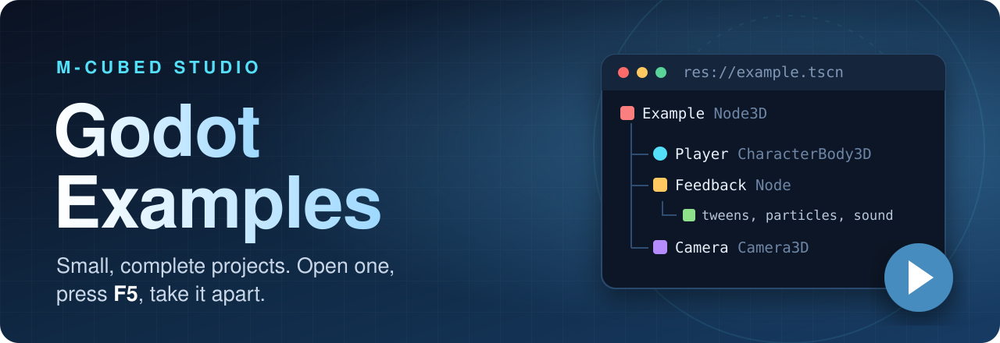

<p align="center">
  
</p>

<p align="center">
  <a href="https://godotengine.org"></a>
  <a href="LICENSE"></a>
  
</p>

<p align="center">
  <b>One technique per folder.</b> Each example is a tiny, standalone Godot project that does one
  thing well, with a README that walks you through how it works and what to tune.
</p>

---

## ▶ Run any example in a minute

```bash
git clone https://github.com/mcubedstudiobe/godot-examples.git
```

1. Open the Godot project manager and choose **Import**.
2. Pick the `project.godot` inside the example's folder.
3. Press **F5**.

Every example ships with the assets it needs, so there is nothing else to install. The Godot
version it was built with is in its README.

## 🗂 Find an example

Every folder at the top of this repository (apart from `.github`) is one example, named after what
it teaches. Open the folder and start with its `README.md`.

## 📦 What you get in every folder

<table>
  <tr>
    <td width="33%" valign="top">
      <h3>📖 A README</h3>
      What the example shows, the controls, how each piece is built, and what to tune.
    </td>
    <td width="33%" valign="top">
      <h3>🎮 A runnable project</h3>
      Its own <code>project.godot</code>, scenes and assets. Nothing shared, nothing to set up.
    </td>
    <td width="33%" valign="top">
      <h3>🧩 Code to take apart</h3>
      Small scripts that read in one sitting, with the important lines explained.
    </td>
  </tr>
</table>

## ♻ Use it in your game

Copy whatever helps. Our code is MIT: keep the licence notice and ship it. Third-party assets
(characters, sounds and the like) keep their own licences, which sit next to them in each
example; check those before you reuse an asset.

## Licence

[MIT](LICENSE) for the code in this repository. Third-party assets are credited, with their
licences, in the example that uses them.

<p align="center"><sub>Made with Godot by M-Cubed Studio.</sub></p>
